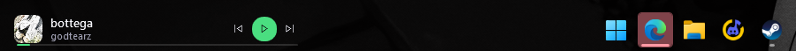
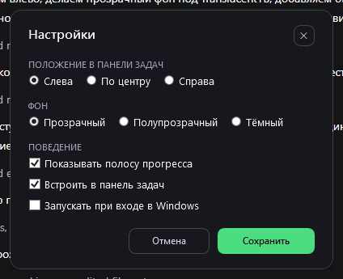

# TrayTune

Мини-плеер прямо в панели задач Windows 11: обложка, трек, play/pause, перемотка.
Работает со Spotify, Яндекс.Музыкой в браузере и любым другим плеером — без их API.

*Mini player that lives inside the Windows 11 taskbar. Talks to any player through
the system media session (SMTC) — no Spotify/Yandex API keys needed.*



## Возможности

- **Встроен в панель задач**, а не висит поверх неё: окно становится дочерним для
  `Shell_TrayWnd` и выглядит как часть панели.
- **Прозрачный фон** — под панель задач с TranslucentTB и подобными утилитами.
  Три варианта: прозрачный / полупрозрачный / тёмный.
- **Положение**: слева, по центру или справа. Слева не наезжает на кнопку «Пуск».
- **Цвет акцента по источнику**: Spotify — зелёный, Яндекс — жёлто-оранжевый,
  остальные — синий. Плюс ручной выбор, включая градиент «волны» (цвет коллекции
  Яндекс.Музыки). Браузер не сообщает, какой сайт играет, поэтому для Яндекса в
  браузере цвет выбирается вручную.
- **Любой источник**: Spotify, Яндекс.Музыка (браузер), VLC, AIMP — всё, что
  публикует медиасессию в Windows. Переключение в правом клике.
- **Не крадёт фокус** (`WS_EX_NOACTIVATE`) и не показывается в Alt-Tab: можно
  щёлкать по кнопкам, не выходя из игры.
- Обложка, название, артист, полоса прогресса с перемоткой по клику. Обложка
  подтягивается и для браузерных сессий (Яндекс.Музыка отдаёт 150×150).
- **Три ширины** виджета: узкая, обычная, широкая.
- Иконка в трее, автозапуск, одна копия приложения.
- Обычный режим тоже есть: отстыкованный виджет у панели задач, его можно таскать.



## Как это работает

**Медиа.** `Windows.Media.Control.GlobalSystemMediaTransportControlsSessionManager` —
системный интерфейс, через который плеер публикует трек, обложку, позицию и
принимает команды. Один код обслуживает все плееры сразу; OAuth, токены и
реверс-инжиниринг не нужны.

**Встраивание.** `SetParent(hwnd, Shell_TrayWnd)` сам по себе ничего не даёт:
окно остаётся top-level (`WS_POPUP`), а `GetParent` возвращает владельца. Поэтому
после `SetParent` стиль окна переключается на `WS_CHILD` — только тогда окно
действительно становится частью панели. Обратный переход возвращает `WS_POPUP`.

**Позиция слева.** Значки приложений в Windows 11 рисует XAML, отдельных HWND у
них нет. Границу блока кнопок берём через UI Automation (`TaskbarLayout`), чтобы
не поставить виджет на кнопку «Пуск».

## Требования

- Windows 10 2004+ или Windows 11 (проверялось на Windows 11).
- [.NET 10 Desktop Runtime](https://dotnet.microsoft.com/download) для готового exe
  (или .NET 10 SDK для сборки).

## Запуск

1. Скачать `TrayTune.exe` из [Releases](../../releases) или собрать самому.
2. Запустить. Правый клик по виджету (или иконка в трее) → **Настройки**.

Горячие клавиши не нужны: мультимедийные клавиши клавиатуры работают через саму
Windows.

## Сборка

```bat
build-release.cmd
build-portable.cmd
```

`build-release.cmd` — `dist\TrayTune.exe`, один файл, ~25 МБ, требует
установленный .NET 10. `build-portable.cmd` — self-contained версия в
`dist-portable`, ~70 МБ, .NET на машине не нужен: скопировал exe и запустил.

Вручную:

```bash
dotnet publish player/TrayTune.csproj -c Release -r win-x64 \
  --self-contained false -p:PublishSingleFile=true -o dist
```

## Настройки

Хранятся в `%LOCALAPPDATA%\TrayTune\settings.json`:

| Параметр | Значения | По умолчанию |
|---|---|---|
| `Placement` | `Left`, `Center`, `Right` | `Left` |
| `Background` | `Transparent`, `Translucent`, `Solid` | `Transparent` |
| `ShowProgress` | `true` / `false` | `true` |
| `Accent` | `Auto`, `Spotify`, `Yandex`, `Wave`, `Other` | `Auto` |
| `WidgetWidth` | 280 / 340 / 400 | `340` |
| `Docked` | встроен в панель задач | `false` |
| `Autostart` | запуск при входе в Windows (HKCU\...\Run) | `false` |

## Ограничения

- Панель задач предполагается снизу. При панели сверху/слева позиционирование
  нужно править в `TaskbarHost`.
- **Перезапуск explorer.exe закрывает встроенный виджет** — окно-ребёнок гибнет
  вместе с родителем. Запустите приложение снова, режим запомнится.
- Браузерная сессия живёт только пока идёт воспроизведение — так устроен SMTC.
- Часть сайтов отдаёт в SMTC обложку хуже, чем десктопный клиент.
- Режим встраивания — экспериментальный: он опирается на внутреннее устройство
  панели задач и может сломаться после крупного обновления Windows.

## Структура

```
player/                 WPF-приложение
  MainWindow.xaml       виджет: обычный и компактный вид
  SettingsWindow.xaml   окно настроек
  MediaSessionService.cs  обёртка над SMTC
  TaskbarHost.cs        встраивание в панель задач
  TaskbarLayout.cs      границы кнопок панели через UI Automation
  Native.cs             Win32: стили окна, SetParent, DPI
  Settings.cs           модель настроек
  Autostart.cs          автозапуск через реестр
spike/                  консольный зонд SMTC (диагностика)
tools/                  вспомогательные скрипты: скриншоты, клики, иконка
```

`spike` полезен, если что-то не видно: `spike.cmd` печатает все медиасессии,
их состояние, таймлайн и наличие обложки.

## Лицензия

MIT — см. [LICENSE](LICENSE).
